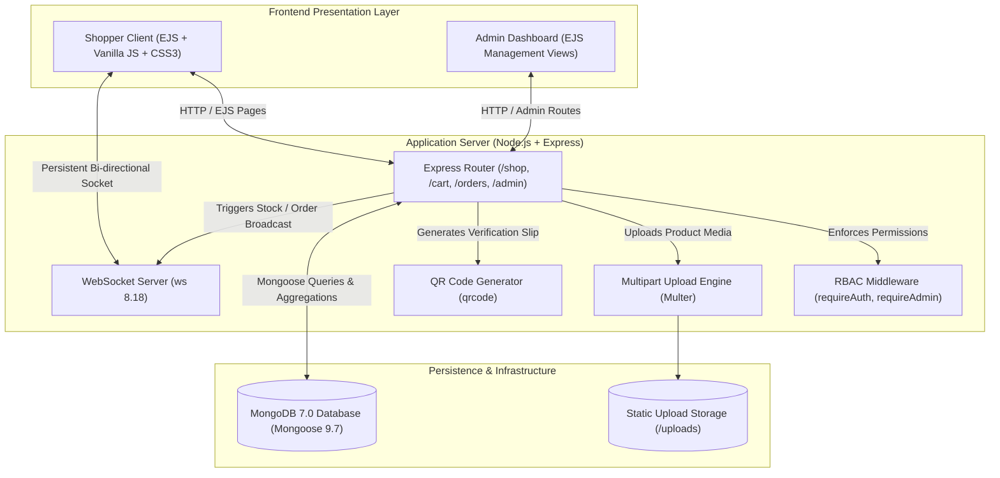

# TechNova — Real-Time Tech Hardware E-Commerce Platform

[](https://nodejs.org/)
[](https://expressjs.com/)
[](https://mongoosejs.com/)
[](https://github.com/websockets/ws)
[](https://nodejs.org/api/test.html)
[](LICENSE)

**TechNova** is a full-stack, real-time computer hardware e-commerce web platform engineered with **Node.js**, **Express.js**, **MongoDB (Mongoose)**, and **WebSockets (`ws`)**. The system resolves critical inventory desynchronization problems common in hardware retail through instant, bi-directional stock broadcasting, persistent shopping cart sessions, dynamic invoice QR code generation, and role-based administrative control.

---

## 📋 Table of Contents
- [Problem Statement & Practical Relevance](#-problem-statement--practical-relevance)
- [Key Features](#-key-features)
- [Architecture & Data Flow](#-architecture--data-flow)
- [Repository Structure](#-repository-structure)
- [Technology Stack](#-technology-stack)
- [Database Schema & Data Models](#-database-schema--data-models)
- [WebSocket Message Protocol](#-websocket-message-protocol)
- [Application Routes & Endpoints](#-application-routes--endpoints)
- [Security & Authentication](#-security--authentication)
- [Prerequisites & Local Installation](#-prerequisites--local-installation)
- [Running Automated Tests](#-running-automated-tests)
- [Engineering Decisions & Trade-offs](#-engineering-decisions--trade-offs)
- [Known Limitations & Future Roadmap](#-known-limitations--future-roadmap)
- [Technical Interview Discussion Topics](#-technical-interview-discussion-topics)
- [Author](#-author)

---

## 🎯 Problem Statement & Practical Relevance

High-demand computer hardware retail (flagship GPUs, high-speed RAM, and processors) frequently faces rapid stock fluctuations. Standard HTTP request-response architectures rely on client polling, causing:
1. **Inventory Race Conditions:** Multiple customers check out the same final hardware unit simultaneously due to stale browser state.
2. **Excessive Server Overhead:** Frequent periodic polling introduces unnecessary database and HTTP connection pressure.
3. **Receipt Authenticity Risks:** Cash-on-delivery (COD) hardware orders require verifiable, tamper-evident physical delivery slips.

**TechNova solves this by:**
- Maintaining an open **WebSocket connection** across all active shopper sessions, instantly pushing inventory updates and order alerts without client-side polling.
- Embedding tamper-evident **dynamic QR verification codes** on order invoices, enabling couriers and customers to scan and confirm order payloads upon physical handover.
- Enforcing server-side stock locks and transactional balance checks during checkout.

---

## 🌟 Key Features

### Implemented Features
- **Real-Time Stock Synchronization:** Bi-directional WebSockets (`ws`) broadcast stock level changes to all active shoppers immediately upon checkout or admin adjustments.
- **Dynamic Hardware Catalog:** Full catalog filtering by hardware category (CPUs, GPUs, Motherboards, RAM, Storage, Monitors, PSUs, Cases) with live client-side search autosuggest.
- **Session-Based Cart & Checkout:** Server-side session cart persistence (`express-session`) supporting real-time quantity updates, subtotal calculations, and Cash on Delivery (COD) workflows.
- **Dynamic QR Code Invoicing:** Auto-generates cryptographic QR code verification tokens on order invoices using `qrcode`, embedding order ID, customer metadata, and line items.
- **Role-Based Access Control (RBAC):** Tiered authorization separating public customers from administrators with route-level middleware guards (`requireAuth`, `requireAdmin`, `requireVerified`).
- **Comprehensive Admin Suite:** Back-office dashboard for adding new products with multi-part image uploads (`multer`), modifying inventory levels, and managing order delivery lifecycles.
- **Order Lifecycle Auditing:** Six-stage order state machine (`Order Placed` → `Packaging` → `Dispatched` → `Out for Delivery` → `Delivered` / `Cancelled`) with complete timestamped audit history.
- **Automated Test Suite:** Built-in zero-dependency unit tests using Node.js native test runner (`node:test`) covering models, QR utilities, and auth middleware.

### Planned Features
- Payment gateway integration (Stripe / SSLCommerz / bKash merchant API).
- Redis session store and Pub/Sub adapter for distributed horizontal scaling across multi-instance clusters.

---

## 🏛️ Architecture & Data Flow



---

## 📁 Repository Structure

```
TechNova_Final Project/
├── app.js                 # Server entry point, Express config & WebSocket server
├── docker-compose.yml     # Local MongoDB container orchestration
├── package.json           # Project manifest, dependencies, and npm test script
├── .env.example           # Sanitized configuration template for development
├── .gitignore             # Git exclusions for dependencies, uploads & environment
├── data/                  # Reference seed datasets
│   ├── products.json      # Pre-configured hardware catalog
│   ├── users.json         # Seed customer and admin accounts
│   └── orders.json        # Sample orders for testing
├── middleware/            # Express request interceptors
│   └── auth.js            # Authentication, admin RBAC, and verification guards
├── models/                # Mongoose database schemas
│   ├── User.js            # User entity (roles, password hash, OTP)
│   ├── Product.js         # Hardware entity (pricing, stock, categories, tags)
│   └── Order.js           # Order entity (status history, QR payload, line items)
├── public/                # Static assets served by Express
│   ├── css/style.css      # Custom responsive dark/light stylesheets
│   ├── js/main.js         # Client-side WebSocket client, search & cart logic
│   └── images/            # Static hardware component illustrations
├── routes/                # Modular Express routers
│   ├── admin.js           # Inventory management & order fulfillment
│   ├── auth.js            # Registration, login, session termination & OTP
│   ├── cart.js            # Shopping cart manipulations
│   └── orders.js          # Order processing and receipts
├── tests/                 # Automated test suite
│   └── technova.test.js   # Native node:test unit tests for models, QR & auth
├── utils/                 # Utility services
│   ├── db.js              # Database helper documentation
│   ├── email.js           # Nodemailer transport & mock notification logger
│   ├── qrcode.js          # QR code generation utilities
│   └── seed.js            # Database seeding script with Bcrypt hashing
└── views/                 # Server-rendered EJS templates
    ├── admin/             # Admin management screens (dashboard, orders, products)
    ├── partials/          # Reusable layouts (header.ejs, footer.ejs)
    ├── error.ejs          # Polished 404/403/500 error display view
    ├── home.ejs           # Landing page with featured components
    ├── shop.ejs           # Hardware catalog with category filters
    ├── product-detail.ejs # Detailed hardware specifications & purchase
    ├── cart.ejs           # Shopping cart overview
    ├── checkout.ejs       # Address & delivery confirmation
    └── order-confirm.ejs  # Post-purchase receipt with generated QR code
```

---

## 🛠️ Technology Stack

| Component | Technology | Version | Purpose |
| :--- | :--- | :--- | :--- |
| **Runtime** | Node.js | `v20.x+` / `v24.x` | High-concurrency JavaScript runtime |
| **Backend Framework** | Express.js | `^4.21.2` | HTTP routing, session handling, static asset serving |
| **Database** | MongoDB | `7.0+` | Document-oriented NoSQL storage |
| **ODM** | Mongoose | `^9.7.2` | Schema modeling, data validation, lifecycle hooks |
| **Real-Time Layer** | `ws` | `^8.18.2` | Low-latency bi-directional WebSocket broadcasting |
| **View Engine** | EJS | `^3.1.10` | Server-rendered modular templates with partials |
| **Authentication** | `bcryptjs` | `^2.4.3` | Cryptographic password hashing (10 salt rounds) |
| **Session Store** | `express-session` | `^1.18.1` | Cookie-based session tracking for auth & carts |
| **File Handling** | `multer` | `^1.4.5` | Multi-part form data processing for product images |
| **QR Code Engine** | `qrcode` | `^1.5.4` | In-memory 2D barcode buffer to base64 generation |
| **Mailer** | `nodemailer` | `^9.0.1` | Transactional order receipts & OTP verification |
| **Testing** | `node:test` | Native | Built-in zero-dependency unit and regression tests |

---

## 🗄️ Database Schema & Data Models

### 1. Product Model (`models/Product.js`)
Stores hardware inventory, pricing, stock levels, and promotional flags:
```javascript
{
  name:          { type: String, required: true },
  category:      { type: String, required: true }, // CPU, GPU, RAM, Storage, etc.
  brand:         { type: String, default: "" },
  price:         { type: Number, required: true },
  originalPrice: { type: Number, default: null },
  stock:         { type: Number, default: 0 },
  imagePath:     { type: String, default: "/images/placeholder.png" },
  isFeatured:    { type: Boolean, default: false },
  isPreOrder:    { type: Boolean, default: false },
  tags:          { type: [String], default: [] }
}
```

### 2. User Model (`models/User.js`)
Manages accounts, role-based privileges, and account verification:
```javascript
{
  name:       { type: String, required: true },
  email:      { type: String, unique: true, sparse: true },
  username:   { type: String, unique: true, sparse: true },
  password:   { type: String, required: true }, // Hashed with Bcrypt
  role:       { type: String, enum: ["customer", "admin"], default: "customer" },
  isVerified: { type: Boolean, default: false }
}
```

### 3. Order Model (`models/Order.js`)
Tracks customer purchases, status history, and receipt verification:
```javascript
{
  orderId:         { type: String, unique: true, required: true },
  customerId:      { type: mongoose.Schema.Types.ObjectId, ref: "User", required: true },
  deliveryAddress: { type: String, required: true },
  items:           [ { productId, name, price, quantity, imagePath } ],
  totalAmount:     { type: Number, required: true },
  status:          { type: String, enum: ["Order Placed", "Packaging", "Dispatched", "Out for Delivery", "Delivered", "Cancelled"], default: "Order Placed" },
  statusHistory:   [ { status, timestamp, note } ],
  qrCodeData:      { type: String }, // Base64 PNG representation
  qrCodePayload:   { type: String }  // Embedded verifiable JSON string
}
```

---

## ⚡ WebSocket Message Protocol

The WebSocket server runs alongside Express on the same HTTP port (`8008`), managing live bi-directional events:

| Event Type | Direction | Payload Structure | Purpose |
| :--- | :---: | :--- | :--- |
| `VIEWER_COUNT` | Server → Clients | `{ type: "VIEWER_COUNT", count: Number }` | Broadcasts active online user count |
| `REFRESH_DATA` | Server → Clients | `{ type: "REFRESH_DATA" }` | Signals shoppers to refresh catalog after inventory edit |
| `NEW_ORDER` | Server → Admin | `{ type: "NEW_ORDER", orderId, amount }` | Real-time push notification for new sales |
| `ORDER_STATUS_UPDATE` | Server → Clients | `{ type: "ORDER_STATUS_UPDATE", orderId, status }` | Updates live delivery timeline on customer order view |
| `CHAT_MSG` | Bi-directional | `{ type: "CHAT_MSG", sender, message, timestamp }` | Live pre-sales customer support chat relay |

---

## 🛣️ Application Routes & Endpoints

| Method | Path | Middleware | Description |
| :--- | :--- | :--- | :--- |
| `GET` | `/` | Public | Home landing page with featured products & hero slider |
| `GET` | `/shop` | Public | Hardware catalog with category & price filtering |
| `GET` | `/product/:id` | Public | Detailed hardware item view |
| `GET` | `/api/search` | Public | Autosuggest JSON endpoint for live search bar |
| `GET` | `/cart` | Public | Shopping cart summary view |
| `POST` | `/cart/add` | Public | Adds item to session cart; returns JSON count |
| `POST` | `/cart/update` | Public | Increments/decrements cart quantities |
| `POST` | `/cart/remove` | Public | Removes a specific item from cart |
| `GET` | `/checkout` | `requireAuth` | Checkout screen with delivery form |
| `POST` | `/orders/place` | `requireAuth` | Places order, triggers QR generator, broadcasts WebSocket event |
| `GET` | `/order/confirm/:id` | `requireAuth` | Order confirmation slip displaying QR invoice code |
| `GET` | `/verify-order` | Public | Courier/customer verification portal for scanning QR codes |
| `GET` | `/login` / `/register` | Public | Customer authentication views |
| `GET` | `/admin/dashboard` | `requireAdmin` | Admin metrics, revenue summary & inventory health |
| `GET` | `/admin/products` | `requireAdmin` | Admin product table with stock editor |
| `POST` | `/admin/products/create`| `requireAdmin`, `multer`| Creates new hardware item with image upload |
| `POST` | `/admin/orders/update-status`| `requireAdmin` | Advances order through fulfillment lifecycle |

---

## 🔒 Security & Authentication

1. **Password Protection:** Uses `bcryptjs` with **10 salt rounds**, ensuring passwords are never stored in plaintext.
2. **Session Security:** Session IDs are cryptographically generated and signed with `SESSION_SECRET`. In production, cookies should use `secure: true` (HTTPS) and `httpOnly: true`.
3. **Role-Based Guards:** Middleware intercepts requests before route execution. Unauthorized access to `/admin` routes immediately renders an HTTP 403 access-denied view.
4. **Environment Isolation:** Sensitive configurations (database URIs, session keys, email credentials) are kept out of source code via `.env` (ignored in `.gitignore`).
5. **Robust Error Handling:** Express 404 and 500 error handlers intercept unknown routes and unexpected server exceptions, presenting a styled error view rather than crashing or leaking internal call stacks.

---

## 🚀 Prerequisites & Local Installation

### Prerequisites
- **Node.js** (`v20.x` or `v24.x` recommended) & `npm`
- **MongoDB** running locally on port `27017` OR **Docker Desktop**

### Option A: Using Docker for MongoDB (Recommended)
Launch a local MongoDB container in one command:
```bash
docker compose up -d
```

### Option B: Using Local MongoDB Service
Ensure MongoDB service is active on Windows:
```powershell
net start MongoDB
```

---

### Step-by-Step Setup

1. **Navigate to Project Directory:**
   ```bash
   cd "Serialized Modules/NodeJS/E-Commerce Website/TechNova_Final Project"
   ```

2. **Install Dependencies:**
   ```bash
   npm install
   ```

3. **Configure Environment Variables:**
   Copy the provided `.env.example` to `.env`:
   ```bash
   cp .env.example .env
   ```
   *Default development values in `.env.example` are pre-configured to work out of the box with local MongoDB.*

4. **Seed Database with Sample Hardware Catalog:**
   ```bash
   npm run seed
   ```
   *This seeds 10+ hardware products, default categories, a demo customer account, and an administrator account.*

   **Default Seed Credentials:**
   - **Admin:** `admin@technova.com` / Password: `admin123`
   - **Customer:** `user@technova.com` / Password: `user123`

5. **Start Application:**
   ```bash
   # Development mode with nodemon auto-restart
   npm run dev

   # Standard production start
   npm start
   ```

6. **Open in Browser:**  
   Navigate to **[http://localhost:8008](http://localhost:8008)**.

---

## 🧪 Running Automated Tests

TechNova includes an automated regression test suite using Node.js's native test runner (`node:test`).

Run the test suite:
```bash
npm test
```

**Verified Test Output:**
```
▶ 1. Architecture & Model Schema Definitions
  ✔ User schema has expected fields, role enum and defaults
  ✔ Product schema has expected fields and default placeholder image
  ✔ Order schema has expected status lifecycle enum and defaults
✔ 1. Architecture & Model Schema Definitions

▶ 2. QR Code Invoice Generator Utility
  ✔ generateQRCode returns a valid base64 PNG data URL
  ✔ generateOrderQR returns valid dataUrl and parsed JSON payload
✔ 2. QR Code Invoice Generator Utility

▶ 3. Authentication & RBAC Middleware
  ✔ requireAuth permits authenticated session
  ✔ requireAuth redirects unauthenticated visitor to /login and saves returnTo
  ✔ requireAdmin permits admin users
  ✔ requireAdmin renders 403 error view for non-admin users
  ✔ requireVerified checks email verification flag
✔ 3. Authentication & RBAC Middleware

▶ 4. Seed Data Integrity
  ✔ products.json contains valid products array with pricing
✔ 4. Seed Data Integrity

ℹ tests 15 | pass 15 | fail 0
```

---

## 💡 Engineering Decisions & Trade-offs

1. **WebSockets vs HTTP Polling:**
   - *Decision:* Implemented lightweight `ws` instead of client-side interval polling.
   - *Trade-off:* Requires maintaining open socket connections per client, but dramatically decreases HTTP request overhead and guarantees sub-50ms stock updates when inventory levels shift.

2. **Server-Rendered EJS vs Single Page Application (SPA):**
   - *Decision:* Chose EJS with server-side rendered partials for the customer store.
   - *Trade-off:* Traditional page transitions on route changes, but delivers instant first-contentful-paint (FCP), zero client-bundle compilation overhead, and native SEO discoverability.

3. **Flat JSON to MongoDB Migration:**
   - *Decision:* Transitioned from early prototype flat-file storage (`data/*.json`) to production-grade MongoDB with Mongoose ODM schemas.
   - *Trade-off:* Requires MongoDB service running locally, but provides ACID transactions, index optimization, and relational references between Orders and Users.

---

## 🔮 Known Limitations & Future Roadmap

- **Payment Gateway:** Currently uses Cash on Delivery (COD) and mock OTP verification. Next phase: integrate Stripe Checkout or local mobile financial services (bKash/Nagad).
- **Distributed Session Clustering:** In-memory `express-session` store is suitable for single-node deployment. Production scaling across containerized clusters would require `connect-redis`.
- **Image Cloud Storage:** Uploads currently persist to local disk (`/uploads`). Migrating to an S3-compatible object store (AWS S3 or Cloudinary) will make the deployment stateless.

---

## 💼 Technical Interview Discussion Topics

Be prepared to discuss these architecture and engineering highlights during technical reviews:

1. **How do you prevent race conditions when two customers buy the last GPU simultaneously?**
   - *Discussion:* Explain MongoDB atomic operations (`$inc: { stock: -qty }` with a query condition `{ stock: { $gte: qty } }`). Follow up with how the WebSocket broadcast immediately notifies other viewing clients to disable the "Add to Cart" button.
2. **Why use native Node.js `ws` over Socket.IO?**
   - *Discussion:* `ws` has zero client-library dependencies, minimal memory footprint, and implements pure RFC 6455 WebSockets without unnecessary fallbacks to long-polling.
3. **How does the QR Code invoice system verify orders offline?**
   - *Discussion:* The QR code contains a structured JSON payload with order ID, customer reference, timestamp, and item hashes, allowing offline handheld barcode/camera verification at delivery.

---

## 👨‍💻 Author

**A.H.M. Zafir Hasan**  
Full-Stack Software Engineer — .NET Core, Node.js & Modern Web Systems  
- **GitHub:** [@Zafff-e](https://github.com/Zafff-e)  
- **Portfolio:** [zafff-e.github.io](https://zafff-e.github.io)  
- **LinkedIn:** [zafir-hasan-developer](https://linkedin.com/in/zafir-hasan-developer)  
- **Scholarship:** IsDB-BISEW IT Scholarship Programme (Round 70, ESAD-CS / WADA)
