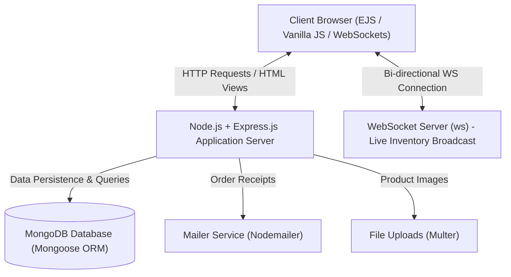

# TechNova — Real-Time Tech Hardware E-Commerce Platform


TechNova is a full-stack, real-time computer hardware and electronics e-commerce web application. Built with **Node.js**, **Express.js**, **MongoDB (Mongoose)**, and bi-directional **WebSockets (`ws`)**, the platform provides instant live inventory level synchronization, responsive shopping cart sessions, dynamic invoice QR code generation, and automated transactional emails.

---

## 🌟 Key Features

- **Real-Time Stock Updates (WebSockets):** Live stock and inventory count broadcast across all connected browser clients with zero polling latency.
- **Dynamic Catalog & Filtering:** Browse, search, and filter hardware components (CPUs, GPUs, Motherboards, RAM, Storage, PSUs) with category-driven navigation.
- **Session-Based Cart & Checkout:** Persistent shopping cart sessions with real-time subtotal, quantity updates, and cash-on-delivery checkout workflow.
- **Dynamic QR Code Invoicing:** Auto-generates scannable QR code verification tokens on order invoices for order confirmation and dispatch tracking.
- **Authentication & RBAC:** Secure password hashing with **Bcrypt**, session-based auth, and dedicated admin dashboard for inventory management.
- **Transactional Email Notifications:** Automated order receipts and notifications using **Nodemailer** (Ethereal test mode / Gmail SMTP).
- **Admin Management Panel:** Comprehensive product creation, image uploading via **Multer**, stock adjustments, and order status updates.

---

## 🏗️ Architecture & Tech Stack



### Technology Highlights
- **Runtime & Framework:** Node.js, Express.js (v4.21)
- **Database & Modeling:** MongoDB, Mongoose ODM (v9.7)
- **Real-Time Layer:** `ws` (WebSocketServer v8.18)
- **Templating & UI:** EJS (Embedded JavaScript), CSS3, Vanilla JS
- **Security:** `bcryptjs` (Password Hashing), `express-session` (Session Management)
- **Utilities:** `multer` (Image Uploads), `qrcode` (Dynamic Invoice QR Codes), `nodemailer` (Emailing)

---

## 📂 Project Structure

```
TechNova_Final Project/
├── app.js                 # Main server entry point & WebSocket wiring
├── data/                  # Initial seed data and schemas
├── middleware/            # Auth guard, admin guard, upload middleware
├── models/                # Mongoose models (User, Product, Order)
├── public/                # Static assets (CSS, client JS, images)
├── routes/                # Modular Express routers
│   ├── admin.js           # Admin inventory and orders management
│   ├── auth.js            # Login, registration, and logout
│   ├── cart.js            # Shopping cart management
│   ├── orders.js          # Order processing and receipts
│   └── shop.js            # Product catalog browsing and details
├── uploads/               # Uploaded product imagery
├── utils/                 # Emailer, seed utility, QR code generators
└── views/                 # EJS templates and partials
```

---

## ⚙️ Local Setup & Installation

### Prerequisites
- [Node.js](https://nodejs.org/) (v18.x or v20.x+)
- [MongoDB](https://www.mongodb.com/try/download/community) installed and running locally on port `27017`

### 1. Clone the Repository
```bash
git clone https://github.com/Zafff-e/TechNova-RealTime-Hardware-Ecommerce.git
cd TechNova-RealTime-Hardware-Ecommerce
```

### 2. Install Dependencies
```bash
npm install
```

### 3. Environment Configuration
Copy the `.env.example` file to `.env` and configure your settings:
```bash
cp .env.example .env
```
Default configuration:
```env
PORT=8008
NODE_ENV=development
MONGODB_URI=mongodb://localhost:27017/technova
SESSION_SECRET=your_secure_session_secret_here
EMAIL_MODE=ethereal
```

### 4. Seed Initial Products (Optional)
```bash
npm run seed
```

### 5. Launch the Application
```bash
# Production start
npm start

# Development mode (auto-reload with nodemon)
npm run dev
```

Open your browser and navigate to: **`http://localhost:8008`**

---

## 👤 Author
**A.H.M. Zafir Hasan**  
Full-Stack Developer • .NET, Mobile & Web Systems  
- **GitHub:** [@Zafff-e](https://github.com/Zafff-e)  
- **Portfolio:** [zafff-e.github.io](https://zafff-e.github.io)  
- **LinkedIn:** [zafir-hasan-developer](https://linkedin.com/in/zafir-hasan-developer)
